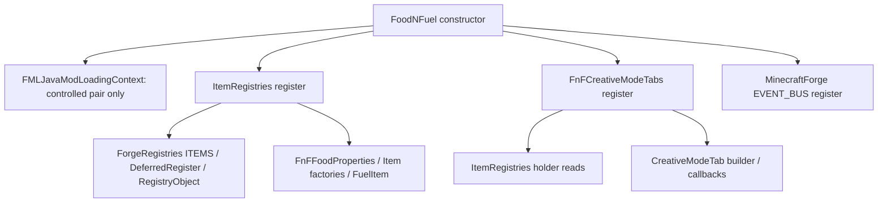

# Food N Fuel API使用图谱

日期：2026-10-15（Asia/Shanghai）。独立 Draft [PR #22](https://github.com/GFander/DualForge/pull/22)，base 为未合并 PR #21 分支。任务起点 `29893683ea584b26208eb205b819c3f3376147be`，实际被测工具源码 `25571c40671d6d80ca10a4dcec77db84440ff555`。生产目录与起点逐文件相同。

原始固定SHA的五个class全部扫描：FoodNFuel、ItemRegistries、FnFCreativeModeTabs、FnFFoodProperties、FuelItem。每项使用点保留class、method+descriptor、ASM指令索引、kind、owner/name/descriptor/opcode、来源、候选和判定；Java行号不作为身份。声明、父类/接口、generic、注解、Frame、所有指令、BSM/Handle/indy/condy和字符串都在扫描面内。额外发现一个外部override契约（FuelItem的getBurnTime），不把它冒充调用指令。

总4030个外部静态使用点，92个唯一外部符号（33类/24字段/35方法），其中576个Forge使用点/16个唯一Forge符号。4029点来自直接扫描及元数据，另1点为继承override关系。70个indy：ItemRegistries67个，Tab类3个；BSM/impl Handle另列，不等于70次实际运行。无已识别Class.forName/loadClass/ServiceLoader等调用，仍不能排除反射、JNI或运行时生成。

| 分类 | 使用点 | 唯一符号 |
|---|---|---|
| ALREADY_COMPATIBLE | 3452 | 75 |
| ALREADY_SUPPORTED_BY_DUALFORGE | 2 | 2 |
| MAPPING_CANDIDATE | 555 | 7 |
| SHIM_REQUIRED | 19 | 7 |
| UNRESOLVED | 2 | 1 |

ALREADY_COMPATIBLE只表示该静态符号存在，成员opcode/access可满足；不是游戏功能PASS。2个DualForge已支持点只限007C-3原入口的get/getModEventBus对。7个Shim符号不能被当前BusView当作一般总线处理。唯一未解符号是org.jetbrains.annotations.Nullable（2个注解点；当前运行依赖无该编译期注解输入），不删除它来提高覆盖率。新通用VERIFIED_RUNTIME=0，通用VERIFIED_STATIC=0；限定fixture的离线证明另行报告，不能给FnF全JAR授予许可。

静态使用图：

按领域的实际使用点：

| 领域 | 点 |
|---|---|
| CREATIVE_TAB | 101 |
| EVENT_BUS | 13 |
| FML_CONTEXT | 4 |
| ITEM_FOOD_FUEL | 1524 |
| JAVA_STANDARD | 919 |
| MINECRAFT | 903 |
| OTHER | 6 |
| REGISTRY | 560 |

全部92个唯一符号及分类（逐点4030项、内部调用和精确BSM图在外部归档）：

| 唯一符号 | 领域 | 分类 |
|---|---|---|
| com/mojang/logging/LogUtils.getLogger()Lorg/slf4j/Logger; | OTHER | ALREADY_COMPATIBLE |
| java/lang/Object | JAVA_STANDARD | ALREADY_COMPATIBLE |
| java/lang/Object.<init>()V | JAVA_STANDARD | ALREADY_COMPATIBLE |
| java/lang/String | JAVA_STANDARD | ALREADY_COMPATIBLE |
| java/lang/invoke/CallSite | JAVA_STANDARD | ALREADY_COMPATIBLE |
| java/lang/invoke/LambdaMetafactory.metafactory(Ljava/lang/invoke/MethodHandles$Lookup;Ljava/lang/String;Ljava/lang/invoke/MethodType;Ljava/lang/invoke/MethodType;Ljava/lang/invoke/MethodHandle;Ljava/lang/invoke/MethodType;)Ljava/lang/invoke/CallSite; | JAVA_STANDARD | ALREADY_COMPATIBLE |
| java/lang/invoke/MethodHandle | JAVA_STANDARD | ALREADY_COMPATIBLE |
| java/lang/invoke/MethodHandles | JAVA_STANDARD | ALREADY_COMPATIBLE |
| java/lang/invoke/MethodHandles$Lookup | JAVA_STANDARD | ALREADY_COMPATIBLE |
| java/lang/invoke/MethodType | JAVA_STANDARD | ALREADY_COMPATIBLE |
| java/util/function/Supplier | JAVA_STANDARD | ALREADY_COMPATIBLE |
| net/minecraft/core/Holder | MINECRAFT | ALREADY_COMPATIBLE |
| net/minecraft/core/registries/Registries.CREATIVE_MODE_TAB:Lnet/minecraft/resources/ResourceKey; | REGISTRY | ALREADY_COMPATIBLE |
| net/minecraft/network/chat/Component | MINECRAFT | ALREADY_COMPATIBLE |
| net/minecraft/network/chat/Component.translatable(Ljava/lang/String;)Lnet/minecraft/network/chat/MutableComponent; | MINECRAFT | ALREADY_COMPATIBLE |
| net/minecraft/network/chat/MutableComponent | MINECRAFT | ALREADY_COMPATIBLE |
| net/minecraft/resources/ResourceKey | MINECRAFT | ALREADY_COMPATIBLE |
| net/minecraft/world/effect/MobEffectInstance | MINECRAFT | ALREADY_COMPATIBLE |
| net/minecraft/world/effect/MobEffectInstance.<init>(Lnet/minecraft/core/Holder;)V | MINECRAFT | ALREADY_COMPATIBLE |
| net/minecraft/world/effect/MobEffectInstance.<init>(Lnet/minecraft/core/Holder;I)V | MINECRAFT | ALREADY_COMPATIBLE |
| net/minecraft/world/effect/MobEffectInstance.<init>(Lnet/minecraft/core/Holder;II)V | MINECRAFT | ALREADY_COMPATIBLE |
| net/minecraft/world/effect/MobEffects.ABSORPTION:Lnet/minecraft/core/Holder; | MINECRAFT | ALREADY_COMPATIBLE |
| net/minecraft/world/effect/MobEffects.CONDUIT_POWER:Lnet/minecraft/core/Holder; | MINECRAFT | ALREADY_COMPATIBLE |
| net/minecraft/world/effect/MobEffects.DAMAGE_BOOST:Lnet/minecraft/core/Holder; | MINECRAFT | ALREADY_COMPATIBLE |
| net/minecraft/world/effect/MobEffects.DAMAGE_RESISTANCE:Lnet/minecraft/core/Holder; | MINECRAFT | ALREADY_COMPATIBLE |
| net/minecraft/world/effect/MobEffects.DIG_SPEED:Lnet/minecraft/core/Holder; | MINECRAFT | ALREADY_COMPATIBLE |
| net/minecraft/world/effect/MobEffects.DOLPHINS_GRACE:Lnet/minecraft/core/Holder; | MINECRAFT | ALREADY_COMPATIBLE |
| net/minecraft/world/effect/MobEffects.FIRE_RESISTANCE:Lnet/minecraft/core/Holder; | MINECRAFT | ALREADY_COMPATIBLE |
| net/minecraft/world/effect/MobEffects.GLOWING:Lnet/minecraft/core/Holder; | MINECRAFT | ALREADY_COMPATIBLE |
| net/minecraft/world/effect/MobEffects.HEAL:Lnet/minecraft/core/Holder; | MINECRAFT | ALREADY_COMPATIBLE |
| net/minecraft/world/effect/MobEffects.HEALTH_BOOST:Lnet/minecraft/core/Holder; | MINECRAFT | ALREADY_COMPATIBLE |
| net/minecraft/world/effect/MobEffects.JUMP:Lnet/minecraft/core/Holder; | MINECRAFT | ALREADY_COMPATIBLE |
| net/minecraft/world/effect/MobEffects.LEVITATION:Lnet/minecraft/core/Holder; | MINECRAFT | ALREADY_COMPATIBLE |
| net/minecraft/world/effect/MobEffects.LUCK:Lnet/minecraft/core/Holder; | MINECRAFT | ALREADY_COMPATIBLE |
| net/minecraft/world/effect/MobEffects.MOVEMENT_SPEED:Lnet/minecraft/core/Holder; | MINECRAFT | ALREADY_COMPATIBLE |
| net/minecraft/world/effect/MobEffects.NIGHT_VISION:Lnet/minecraft/core/Holder; | MINECRAFT | ALREADY_COMPATIBLE |
| net/minecraft/world/effect/MobEffects.REGENERATION:Lnet/minecraft/core/Holder; | MINECRAFT | ALREADY_COMPATIBLE |
| net/minecraft/world/effect/MobEffects.SATURATION:Lnet/minecraft/core/Holder; | MINECRAFT | ALREADY_COMPATIBLE |
| net/minecraft/world/effect/MobEffects.SLOW_FALLING:Lnet/minecraft/core/Holder; | MINECRAFT | ALREADY_COMPATIBLE |
| net/minecraft/world/effect/MobEffects.WATER_BREATHING:Lnet/minecraft/core/Holder; | MINECRAFT | ALREADY_COMPATIBLE |
| net/minecraft/world/food/FoodProperties | ITEM_FOOD_FUEL | ALREADY_COMPATIBLE |
| net/minecraft/world/food/FoodProperties$Builder | ITEM_FOOD_FUEL | ALREADY_COMPATIBLE |
| net/minecraft/world/food/FoodProperties$Builder.<init>()V | ITEM_FOOD_FUEL | ALREADY_COMPATIBLE |
| net/minecraft/world/food/FoodProperties$Builder.alwaysEdible()Lnet/minecraft/world/food/FoodProperties$Builder; | ITEM_FOOD_FUEL | ALREADY_COMPATIBLE |
| net/minecraft/world/food/FoodProperties$Builder.build()Lnet/minecraft/world/food/FoodProperties; | ITEM_FOOD_FUEL | ALREADY_COMPATIBLE |
| net/minecraft/world/food/FoodProperties$Builder.effect(Lnet/minecraft/world/effect/MobEffectInstance;F)Lnet/minecraft/world/food/FoodProperties$Builder; | ITEM_FOOD_FUEL | ALREADY_COMPATIBLE |
| net/minecraft/world/food/FoodProperties$Builder.fast()Lnet/minecraft/world/food/FoodProperties$Builder; | ITEM_FOOD_FUEL | ALREADY_COMPATIBLE |
| net/minecraft/world/food/FoodProperties$Builder.nutrition(I)Lnet/minecraft/world/food/FoodProperties$Builder; | ITEM_FOOD_FUEL | ALREADY_COMPATIBLE |
| net/minecraft/world/food/FoodProperties$Builder.saturationModifier(F)Lnet/minecraft/world/food/FoodProperties$Builder; | ITEM_FOOD_FUEL | ALREADY_COMPATIBLE |
| net/minecraft/world/food/FoodProperties$Builder.usingConvertsTo(Lnet/minecraft/world/level/ItemLike;)Lnet/minecraft/world/food/FoodProperties$Builder; | ITEM_FOOD_FUEL | ALREADY_COMPATIBLE |
| net/minecraft/world/item/CreativeModeTab | CREATIVE_TAB | ALREADY_COMPATIBLE |
| net/minecraft/world/item/CreativeModeTab$Builder | CREATIVE_TAB | ALREADY_COMPATIBLE |
| net/minecraft/world/item/CreativeModeTab$Builder.build()Lnet/minecraft/world/item/CreativeModeTab; | CREATIVE_TAB | ALREADY_COMPATIBLE |
| net/minecraft/world/item/CreativeModeTab$Builder.displayItems(Lnet/minecraft/world/item/CreativeModeTab$DisplayItemsGenerator;)Lnet/minecraft/world/item/CreativeModeTab$Builder; | CREATIVE_TAB | ALREADY_COMPATIBLE |
| net/minecraft/world/item/CreativeModeTab$Builder.icon(Ljava/util/function/Supplier;)Lnet/minecraft/world/item/CreativeModeTab$Builder; | CREATIVE_TAB | ALREADY_COMPATIBLE |
| net/minecraft/world/item/CreativeModeTab$Builder.title(Lnet/minecraft/network/chat/Component;)Lnet/minecraft/world/item/CreativeModeTab$Builder; | CREATIVE_TAB | ALREADY_COMPATIBLE |
| net/minecraft/world/item/CreativeModeTab$DisplayItemsGenerator | CREATIVE_TAB | ALREADY_COMPATIBLE |
| net/minecraft/world/item/CreativeModeTab$ItemDisplayParameters | CREATIVE_TAB | ALREADY_COMPATIBLE |
| net/minecraft/world/item/CreativeModeTab$Output | CREATIVE_TAB | ALREADY_COMPATIBLE |
| net/minecraft/world/item/CreativeModeTab$Output.accept(Lnet/minecraft/world/level/ItemLike;)V | CREATIVE_TAB | ALREADY_COMPATIBLE |
| net/minecraft/world/item/CreativeModeTab.builder()Lnet/minecraft/world/item/CreativeModeTab$Builder; | CREATIVE_TAB | ALREADY_COMPATIBLE |
| net/minecraft/world/item/Item | ITEM_FOOD_FUEL | ALREADY_COMPATIBLE |
| net/minecraft/world/item/Item$Properties | ITEM_FOOD_FUEL | ALREADY_COMPATIBLE |
| net/minecraft/world/item/Item$Properties.<init>()V | ITEM_FOOD_FUEL | ALREADY_COMPATIBLE |
| net/minecraft/world/item/Item$Properties.food(Lnet/minecraft/world/food/FoodProperties;)Lnet/minecraft/world/item/Item$Properties; | ITEM_FOOD_FUEL | ALREADY_COMPATIBLE |
| net/minecraft/world/item/Item$Properties.stacksTo(I)Lnet/minecraft/world/item/Item$Properties; | ITEM_FOOD_FUEL | ALREADY_COMPATIBLE |
| net/minecraft/world/item/Item.<init>(Lnet/minecraft/world/item/Item$Properties;)V | ITEM_FOOD_FUEL | ALREADY_COMPATIBLE |
| net/minecraft/world/item/Item.getBurnTime(Lnet/minecraft/world/item/ItemStack;Lnet/minecraft/world/item/crafting/RecipeType;)I | ITEM_FOOD_FUEL | ALREADY_COMPATIBLE |
| net/minecraft/world/item/ItemStack | ITEM_FOOD_FUEL | ALREADY_COMPATIBLE |
| net/minecraft/world/item/ItemStack.<init>(Lnet/minecraft/world/level/ItemLike;)V | ITEM_FOOD_FUEL | ALREADY_COMPATIBLE |
| net/minecraft/world/item/Items.BOWL:Lnet/minecraft/world/item/Item; | ITEM_FOOD_FUEL | ALREADY_COMPATIBLE |
| net/minecraft/world/item/Items.STICK:Lnet/minecraft/world/item/Item; | ITEM_FOOD_FUEL | ALREADY_COMPATIBLE |
| net/minecraft/world/item/crafting/RecipeType | ITEM_FOOD_FUEL | ALREADY_COMPATIBLE |
| net/minecraft/world/level/ItemLike | MINECRAFT | ALREADY_COMPATIBLE |
| net/minecraftforge/common/MinecraftForge.EVENT_BUS:Lnet/minecraftforge/eventbus/api/IEventBus; | EVENT_BUS | SHIM_REQUIRED |
| net/minecraftforge/eventbus/api/IEventBus | EVENT_BUS | SHIM_REQUIRED |
| net/minecraftforge/eventbus/api/IEventBus.register(Ljava/lang/Object;)V | EVENT_BUS | SHIM_REQUIRED |
| net/minecraftforge/fml/common/Mod | FML_CONTEXT | SHIM_REQUIRED |
| net/minecraftforge/fml/javafmlmod/FMLJavaModLoadingContext | FML_CONTEXT | SHIM_REQUIRED |
| net/minecraftforge/fml/javafmlmod/FMLJavaModLoadingContext.get()Lnet/minecraftforge/fml/javafmlmod/FMLJavaModLoadingContext; | FML_CONTEXT | ALREADY_SUPPORTED_BY_DUALFORGE |
| net/minecraftforge/fml/javafmlmod/FMLJavaModLoadingContext.getModEventBus()Lnet/minecraftforge/eventbus/api/IEventBus; | FML_CONTEXT | ALREADY_SUPPORTED_BY_DUALFORGE |
| net/minecraftforge/registries/DeferredRegister | REGISTRY | MAPPING_CANDIDATE |
| net/minecraftforge/registries/DeferredRegister.create(Lnet/minecraft/resources/ResourceKey;Ljava/lang/String;)Lnet/minecraftforge/registries/DeferredRegister; | REGISTRY | MAPPING_CANDIDATE |
| net/minecraftforge/registries/DeferredRegister.create(Lnet/minecraftforge/registries/IForgeRegistry;Ljava/lang/String;)Lnet/minecraftforge/registries/DeferredRegister; | REGISTRY | MAPPING_CANDIDATE |
| net/minecraftforge/registries/DeferredRegister.register(Ljava/lang/String;Ljava/util/function/Supplier;)Lnet/minecraftforge/registries/RegistryObject; | REGISTRY | MAPPING_CANDIDATE |
| net/minecraftforge/registries/DeferredRegister.register(Lnet/minecraftforge/eventbus/api/IEventBus;)V | REGISTRY | SHIM_REQUIRED |
| net/minecraftforge/registries/ForgeRegistries.ITEMS:Lnet/minecraftforge/registries/IForgeRegistry; | REGISTRY | MAPPING_CANDIDATE |
| net/minecraftforge/registries/IForgeRegistry | REGISTRY | SHIM_REQUIRED |
| net/minecraftforge/registries/RegistryObject | REGISTRY | MAPPING_CANDIDATE |
| net/minecraftforge/registries/RegistryObject.get()Ljava/lang/Object; | REGISTRY | MAPPING_CANDIDATE |
| org/jetbrains/annotations/Nullable | OTHER | UNRESOLVED |
| org/slf4j/Logger | OTHER | ALREADY_COMPATIBLE |

## Registry第一失败链和下一阶段

007C-3实际失败继承：ItemRegistries.<clinit> GETSTATIC ForgeRegistries.ITEMS:IForgeRegistry，缺类。候选是BuiltInRegistries.ITEM:DefaultedRegistry；它须可赋值给目标create(Registry,String)。本轮用真实二进制和受控离线数据流证明该局部关系。
随后每个register(String,Supplier)的结果从RegistryObject变为DeferredHolder，所有字段、GETSTATIC/PUTSTATIC、方法声明/调用/返回、CHECKCAST、Signature和BSM impl类型都要形成同JAR闭包。FnF的67个Item Supplier、Tab对Item holder的引用以及其3个indy都不能被丢弃。
到helper register(Forge IEventBus)V时，旧Context返回的BusView仍非NeoForge IEventBus。无生产解包API；完整离线FnF在RUNTIME_SHIM_REQUIRED明确拒绝，无输出class。更后的Tab、全局bus、Food/Fuel仍未验证。007C-4B优先受控helper Registry闭包和所属ModBus桥接，不能将全Atlas启用；详见交付的10点建议。

## 历史命名事实勘误

旧007C ABI报告写发行字节码含m_/f_。本轮固定原始SHA的新javap、ASM原节点扫描都显示Mojang成员（如Properties.food/stacksTo），SRG成员点为0；旧现场ItemRegistries.javap.txt本身也含Mojang名。保留旧报告和SHA，不改写历史；本轮按实际固定二进制更正结论，不把SRG设为已观察到的FnF阻塞。
