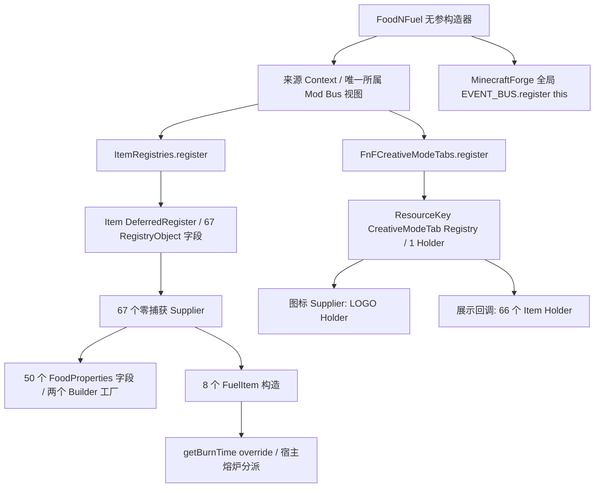

# Convergence-007C-4C-0 FnF兼容缺口报告

日期：2026-10-15 UTC。**本轮静态取证与交付检查 PASS；完整符号解析 PARTIAL（两个 Nullable 注解点未解析），不代表 FnF 兼容 PASS。** `FNF_RUNTIME=NOT RUN`，C4A 历史结论仍为 PARTIAL；客户端、食用、燃烧、UI 和持久化均未在本轮验证。没有生产修改或新转换许可。

## 1. 基线、输入及证据身份

执行 fetch 后，PR #24 已于 2026-10-15T13:35:18Z 合并。起点/main 为 `e40ecaff8b8c286c03f9d269b44a17a465e36a32`，已核对其祖先包含 4B 审计 HEAD `a142e14ed5b3f8a13d28eac7de5142ac2e69eea4`。独立 worktree `/workspace/DualForge-007C4C0`，分支 `codex/convergence-007c4c0-fnf-gap-analysis`，创建时工作区干净；其他 worktree、证据分支和用户修改不动。

固定原发行 `fnf-forge-1.3-1.21.x.jar`，128098 bytes，SHA-256：

`bd415b04529c4ffc31e14757488f71dab6917e4560c61e236c3c4d0de6557958`

使用真实发行全部 ClassFile；不是 GitHub 源码重编产物。读取前后 SHA 一致，无预转换、重包、类定义或初始化。官方平台 ABI 沿用固定 4A 数据集，重新核验 184 项实际依赖/JMOD 与 250 项安装器/Bootstrap checksum，并对相关来源及宿主真实 JAR 新执行 javap。没有重新全扫十万条平台记录，也没有继承旧 FnF 扫描冒充新扫描。

实际环境为 MC 1.21.1、Forge 来源 52.1.0、NeoForge 21.1.256、FML 4.0.45、ModLauncher 11.0.5、Microsoft JDK 21.0.10+7-LTS、Python 3.12.14、Linux x86_64。具体依赖身份和工具输出见本轮[证据索引](Convergence-007C-4C-0%20证据索引.json)。完整 patched client 输入仍缺失，不据服务端 ABI 推断客户端。

## 2. 全量扫描与计数定义

原 JAR 只有以下 5 个 ClassFile；成员枚举与 ZIP 原成员逐一对应，没有额外隐藏类、module-info 或未扫描 ClassFile。所有类 access=33（public/super，非 final）。模块声明缺失不代表无归属：新只读 FML 诊断实际记录 `modId=fnf module=fnf scanClasses=5`；这是 ModFileInfo/SecureJar metadata 身份，不冒充本轮 GAME Layer 运行。沿用原架构，不另建 Layer。

| ClassFile（net/natevg/fnf/ 下） | 父类 | 字段 | 方法 |
|---|---|---:|---:|
| FoodNFuel | java/lang/Object | 2 | 2 |
| item/ItemRegistries | java/lang/Object | 68 | 70 |
| item/FnFCreativeModeTabs | java/lang/Object | 2 | 6 |
| item/FnFFoodProperties | java/lang/Object | 57 | 4 |
| item/custom/FuelItem | net/minecraft/world/item/Item | 1 | 2 |
| 合计 | | 130 | 84 |

字段 descriptor/Signature、flags、注解、方法 descriptor/Signature、局部变量、Frame、maxStack/maxLocals、指令操作数、异常表、BSM/Handle/indy 均保留。当前五类实际异常表数量为 0，分支/跳转指令为 0；不能由此将未来带控制流的 Supplier 自动准入。扫描器另有带分支/异常表的合成负面对照。

本轮两次原发行扫描 SHA 相同：`03c3adce84a837a0c3c1aa030ec234a1dd399be4019e5265ab15858d21e1ea6f`。4030 个外部使用点、92 个唯一符号、576 个 Forge 使用点与 4A 一致。4029 点来自 ClassFile 引用，另 1 点是 FuelItem 的外部 override 契约；声明、generic、调试元数据和指令中的重复符号仍各计使用点，不能只数调用指令。70 个 indy 分开计，不纳入外部符号总数。m_/f_ 命名使用点为 0；该固定发行使用 Mojang 名，当前没有观察到需要 SRG 转换的 FnF 调用。

## 3. 分类及静态可解析边界

六份[机器可读结果](Convergence-007C-4C-0/)入 Git；Schema 为 [fnf-gap.schema.json](../tools/api-atlas/fnf-gap.schema.json)。每份包含输入/扫描/平台数据集 SHA、版本、runtime 状态；类记录及 Supplier 含原 class SHA，使用点有所属类/方法/指令索引，引用图保留唯一证据身份和完整原引用计数。原 ASM、javap、命令和日志附件在 ignored out/，不进 Git。

| 判定 | 全部外部使用点 | 其中 Forge 使用点 | 含义 |
|---|---:|---:|---|
| STATIC_ABI_PRESENT | 3452 | 0 | 宿主静态类型/成员可解析；不是行为等价 |
| EXISTING_PRODUCTION_SUPPORTED | 3 | 3 | 两个 Context 调用点 + 一个 @Mod 扫描身份点 |
| LOCAL_MATCH_GROUP_REJECTED | 558 | 558 | 4B 有相应 Item 边界原语，但 FnF 整组未准入 |
| NEW_ASM_RULE_REQUIRED | 1 | 1 | ResourceKey 类型的 Tab create 调用边界 |
| RUNTIME_BRIDGE_REQUIRED | 14 | 14 | 来源 Context/Bus 类型及全局 Bus 语义等 |
| UNRESOLVED | 2 | 0 | Nullable 编译期注解，保留原记录 |
| 合计 | 4030 | 576 | 92 唯一符号，16 唯一 Forge 符号 |

这是**逐符号/使用点分类**，不是所需改动行数；Supplier 业务、Tab Consumer、泛型和 Bridge Registry-key 等结构阻塞不等于新增 API 符号数。LOCAL_MATCH_GROUP_REJECTED 特别不表示该行已经获得运行转换许可。

4A 曾把 @Mod 点列为 Shim 需求，本轮将其按已存在的 Reader/FML 扫描身份识别记录；不声称为注解增加运行时同名类。Context 两调用精确落到 DualForge 的 ForgeConstructorContext：get 返回该桥接类，getModEventBus 仍返回**来源 Forge IEventBus 视图**，绝不是直接返回 NeoForge Bus。原生 NeoForge API 的同名成员、候选包名对应和现有生产桥接在数据中分别记录。

唯一静态未解析符号为 `org/jetbrains/annotations/Nullable`，两个不可见注解使用点。没有从图中删除，也不把编译期注解缺失预言为实际游戏首失败。Forge 点均有明确裁定类别，但 Context/global Bus 的通用行为、未获准的 Registry 闭包和客户端仍未验证。

## 4. 四条实际闭包链



### A. Item Registry 与 Supplier

实际 Item 初始化路径是 `GETSTATIC ForgeRegistries.ITEMS:IForgeRegistry` → `INVOKESTATIC DeferredRegister.create(IForgeRegistry,String):DeferredRegister` → 67 次 `INVOKEVIRTUAL register(String,Supplier):RegistryObject` → 对应 PUTSTATIC。每个 indy 紧邻实际 register/字段赋值，ID、字段、实现 Handle 和 BSM 单独关联；不是按字段名/类名猜测。

可复用的 4B 原语为：

| 来源 ABI | 宿主或内部边界 | 准确限制 |
|---|---|---|
| ForgeRegistries.ITEMS : IForgeRegistry | BuiltInRegistries.ITEM : DefaultedRegistry | 只证明此 Item Registry receiver 可传给 Registry 参数；不是 IForgeRegistry 全接口等价 |
| DeferredRegister.create(IForgeRegistry,String) | Neo DeferredRegister.create(Registry,String) | 精确 INVOKESTATIC/descriptor、namespace 和 Registry 身份 |
| DeferredRegister.register(String,Supplier):RegistryObject | Neo register(String,Supplier):DeferredHolder | 精确 INVOKEVIRTUAL 和逐次返回/字段闭包 |
| RegistryObject.get():Object | DeferredHolder.get():Object | Holder 来源、CHECKCAST/消费类型、时序共同成立 |
| DeferredRegister.register(Forge IEventBus):void | 内部 ForgeRegistryBridge.register(Object,Forge IEventBus,String):void | 通过验证后才向官方目标 register(Neo IEventBus) 挂接；不直接将两个接口互换 |

源 RegistryObject<T> 只有一个泛型参数，目标 DeferredHolder<R,T extends R> 有两个；4B 仅认可 Item/Item。所有字段、读取/赋值、方法返回、调用、Signature、cast、局部/Frame、Handle/indy 均须一致。字段描述符改了但 Consumer 未改，仍属于未闭包；不能只转换 ItemRegistries 并遗漏 Tab。

67 个 Item Supplier 的互斥分类：

| 分类 | 数量 | 实际结构 |
|---|---:|---|
| 普通 Item | 1 | logo / lambda$static$0，纯 Item(Properties) |
| Item + FoodProperties | 58 | Item(Properties.food(...))，部分带 stacksTo 等原属性调用 |
| 自定义 Item 子类 | 8 | FuelItem(Properties,int)，原 burnTime 参数/字段逻辑保留 |
| 其他/未解析 | 0 | 未丢弃任何 indy |

八个 FuelItem ID 是 paper_stack、bio_fuel、blazing_coal、blazerod_bundle、fire_core、energized_fire_core、soul_fire_core、energized_soul_fire_core。这些名字仅为样本证据，不是生产候选条件。

全部 67 个都是标准 LambdaMetafactory.metafactory、H_INVOKESTATIC 指向本类零参数实现，非捕获型；没有将 FnF 的编译器合成 lambda Handle 冒称源码 Method Reference。原 4B 独立受控 fixture 的静态方法引用仍由其原 Contract 覆盖。其实现参数、返回类型和 BSM 三参数原值见 supplier-classification。

**67 个 Supplier 实现体中的直接 Forge API 指令数为 0。** 因而没有证据要求重写这些业务指令；当前失败来自验证器对业务形态的固定模板，不是这些 Minecraft 调用天然缺少目标。保留业务原字节、只处理 Forge 边界是可研究方案，但必须先验证来源/归属、完整可解析依赖、返回类型、控制流/栈/locals、静态字段初始化顺序及所有实际 API descriptor。未知 Forge 调用/捕获/Bootstrap 或不完整闭包继续拒绝；描述性分类不能代替这套验证器。

第一项 logo 局部形态可匹配既有 7 指令模板；下一 honeyed_potato 含额外 Food 配置，因此受控模板无法覆盖整组。这里只是按字节码推导顺序，**实际自动验收仍只断言精确拒绝原因**，没有虚构新增运行失败栈。

### B. Creative Tab

实际只有 **1 个 Tab**：`fnf_item_tab`。使用 `Registries.CREATIVE_MODE_TAB:ResourceKey`，源 create 描述符为 `(Lnet/minecraft/resources/ResourceKey;Ljava/lang/String;)Lnet/minecraftforge/registries/DeferredRegister;`。宿主同参数 owner 为 Neo DeferredRegister，目标返回其自身类型；方法存在不等于当前 Item-only 规则可接受。

三个 indy 分别是 Tab 注册 Supplier（lambda$static$2）、icon Supplier（lambda$static$0，返回 ItemStack）和 display callback（lambda$static$1，接收 ItemDisplayParameters/Output 返回 void）。全部零捕获，后两项在 Tab Builder 业务体中产生。

icon 从 LOGO Holder.get 构造 ItemStack；display 回调执行 66 次 RegistryObject.get/Output.accept，覆盖除 LOGO 外全部 66 个 Item Holder。Item 应先注册，Holder.get 仅能在正确的 icon/display 生命周期消费；静态构造这些回调不等于此时就执行回调。

需要独立的 typed Tab Registry/DeferredHolder<CreativeModeTab,CreativeModeTab>、Builder、回调及跨 Item Consumer 闭包。当前 Consumer 只允许很窄的静态访问器，不接受这类 Builder/回调；当前内部 Bridge **还要求 getRegistryKey()==Registries.ITEM**，所以即使 Bus 归属正确，也不能把已有桥接原样用于 Tab。需独立验证 Registry-key/挂接契约，不能简单放开为任意 Registry。

### C. Mod Bus 与全局 Bus

构造器顺序为：Object ctor → 唯一 Context get/getModEventBus → ASTORE1 → ItemRegistries.register(Forge IEventBus) → FnFCreativeModeTabs.register(Forge IEventBus) → MinecraftForge.EVENT_BUS.register(this)。两 helper 的实际 descriptor 均为 `(Lnet/minecraftforge/eventbus/api/IEventBus;)V`，不能只换入口描述符而留错 helper ABI。

4B 内部 Bridge 核对当前 owner、ModFile/module、构造调用者、计划 SHA、native receiver、namespace、Registry ITEM 和唯一挂接，再交真实 Mod Bus。它不是全局 Bus 的通用解包 API。

全局 GETSTATIC 的候选为 NeoForge.EVENT_BUS（Neo IEventBus），后续 register(Object)V 在宿主存在。但 Forge/Neo listener 注解、事件类、继承、优先级、取消、分发线程、注册时机均不能仅靠名称或方法存在证明等价。FnF 五类中未发现 SubscribeEvent handler；仍必须保留 register(this) 调用并验证其宿主语义，不能改成 no-op 或删除。

建议单独验证 handler-free instance 的真实官方注册路径，再以独立受控事件检查一个已映射 listener 的实际一次回调；负例覆盖 Mod/Global Bus 混用、未验证事件、static/instance/继承差异、重复与错时注册、priority/cancellation/post 未支持形态。此为设计建议，本轮未实施任何总线 API。

### D. Food / Fuel

FnFFoodProperties 有 **50 个 FoodProperties 字段 + 7 个 int 常量**，不是 57 种 Food；另有 fnfskewer(int) 和 fnfstew(int) 两个 Builder 工厂。实际 nutrition、saturationModifier、alwaysEdible、fast、usingConvertsTo、effect(MobEffectInstance,float)、build 及 Item.Properties.food/stacksTo 等精确成员可在固定宿主解析。部分是平台补丁/继承 API，不把它们笼统称作纯 vanilla。

Neo FoodProperties.Builder 同时有直接 MobEffectInstance 和 Supplier 两种 effect 重载；真实 FnF 用前者，不能误改成后者。食物属性构造/组件静态可解析不保证玩家食用、效果概率、容器返还与动画已经验证。

FuelItem 构造器 `(Item$Properties,int)V` 调用 Item(Properties)，随后保存 burnTime。override `getBurnTime(ItemStack,RecipeType):int` 只读取该实例字段，两个 Nullable 注解仍保留。固定宿主 IItemExtension 提供同签名 inherited 方法；新 javap 还确认真实潜在路径：

`AbstractFurnaceBlockEntity.getBurnDuration(ItemStack)` → `ItemStack.getBurnTime(RecipeType)`（IItemStackExtension 默认实现）→ `Item.getBurnTime(ItemStack,RecipeType)` 的虚调用，具备命中子类 override 的静态路线。

宿主默认 Item 路径使用 FurnaceFuel data map，stack 扩展还含合法性/事件等处理；不能把一个 override 方法存在或静态路径成立写成实际燃料消耗正确。未来须同原 Forge 对照真实熔炉 ticks、消耗、RecipeType 和非燃料负例。当前没有新增 Food/Fuel Shim 的事实依据，也没有本轮游戏行为 PASS。

## 5. 两种当前拒绝与历史真实失败

1. **正常生产候选选择**：4B isCandidate 在入口遇到 MinecraftForge 字段引用即返回 false；FoodNFuel 仍选旧 CONTEXT，不走新 Helper Plan。此规则不使用 fnf/modId/类名/SHA 白名单。
2. **独立强制只读 Plan**：真实 Reader、metadata、ScanResult 下显式 create()，自动断言完整 IllegalStateException 消息 `Registry helper rejected: SUPPLIER_BUSINESS_UNSUPPORTED`。意外接受或其他原因均 FAIL。没有发布任何 FnF helper 改写输出。
3. **历史游戏首异常**：C3 中 `FoodNFuel.<init> → ItemRegistries.<clinit> → NoClassDefFoundError: net/minecraftforge/registries/ForgeRegistries`，属于继承事实，本轮不重跑、不覆盖；不把只读 Plan 拒绝伪装成新的实际运行栈。

本轮重跑真实只读 Contract，前两点直接成立。不存在“强制 Plan 分析过一些指令，所以生产已进入完整 FnF Registry 转换”的结论。单独解除第一个候选边界不能解决第二个闭包边界，更不能宣称越过历史运行异常。

## 6. 设计裁定与后续依赖

| 缺口 | 可复用 | 需要补充 | 关键反例 |
|---|---|---|---|
| Supplier 模板 | 4B metadata/归属、逐注册数据流、clone/ASM 验证 | 独立的 API 边界/类型/依赖验证，保留业务原字节 | 未知 Forge owner、错误返回、捕获、外部 Handle、部分计划失败 |
| Food/自定义类依赖 | 当前静态可解析 MC ABI | owned helper/子类/静态字段与方法闭包，不是按 FuelItem 名白名单 | foreign class、错 descriptor、未解析依赖或类初始化副作用 |
| Tab 与 Holder Consumer | Item Registry 基础和真实 Mod Bus owner 校验 | typed ResourceKey、Tab Holder 双泛型、Builder/回调、Bridge Registry-key 契约 | 错 Registry/泛型、过早 get、漏 consumer、回调捕获、跨类描述符冲突 |
| 全局 Event Bus | 现有 FML 生命周期/来源识别 | 独立注册/事件语义桥接与事件类型裁定 | 把 Mod Bus 当 Global、未知监听器语义、吞调用或 no-op |
| Food/Fuel 行为 | 已存在宿主静态 ABI/override 路线 | 原生-vs-宿主实际行为对照；无证据先不造 Shim | 方法存在但未被实际熔炉分派、错 RecipeType/效果/消耗 |
| 客户端/完整平台图谱 | 现有服务端固定输入 | 完整 patched client ABI 及实机验收 | 用静态资源、旧 cohort 或服务端结果代替渲染 |

**推荐 4C-1 唯一目标：独立实现并验证“保留原业务字节的受控 Item Supplier API 边界准入”。** 不同时做 Tab/全局 Bus，不启用 FnF 全闭包。

预计生产涉及 ForgeRegistryTransformationPlan.supplier 及必要的独立边界验证器/RegistryBytecodeVerifier；沿用原 FML、ModLauncher、ModFile/module、转换计划和克隆提交架构。旧 Profile 保持原验证器/严格负例；不能通过把未知类放行来达成目标。

正例采用身份不同的原生 Forge fixture：普通 Item、FoodProperties 的 Item、独立普通 Item 子类(Properties,int)，先官方 Forge，再同一 JAR NeoForge C/T，查真实注册、次数、Holder/owner Bus/官方 RegisterEvent。保留原 4B fixture/静态方法引用回归。负例须覆盖未知 Forge API/Bootstrap、捕获/foreign owner、错误 field/return/stack、未闭包消费者、部分失败原子性、原生/未认领类、007B/Context/显式 JPMS 原全部拒绝。

验收必须证明业务方法原字节保持，映射只发生于经过验证的 API 边界；不能通过扩大固定物品/构造模板白名单达成。即便 4C-1 受控 fixture PASS，FnF 仍应因 Tab/Global 等未完成边界拒绝。后续 typed Tab、全局 Bus、原 FnF 标准双 JAR 运行和食物/燃料/客户端分别设 Gate，依赖 DAG 见 next-task-dependencies.json。本轮不启动这些实施阶段。

## 7. 实际命令、验证及范围保全

工具/ASM 修改在 `4a2dbf1`；Python 桥接目标裁定补正提交 `ad393d0`。最终设计表另补充实际观察到的 ITEM-only Bridge，重新通过 Schema 与重复数据集一致性检查。最终源码逐文件 SHA、所有命令的 argv、退出状态、stdout/stderr 和结果位置见[索引](Convergence-007C-4C-0%20证据索引.json)。

主要重跑入口：

```zsh
python3 -B tools/api-atlas/atlas.py usage --java-home "$JDK21" \
  --libraries "$NEO_LIBS" --inputs "$FNF_TSV" \
  --output "$NEW/fnf.jsonl.gz" --work "$NEW/tool"
python3 -B tools/api-atlas/fnf_gap.py --scan "$NEW/fnf.jsonl.gz" \
  --atlas "$FIXED_SERVER_ATLAS" --fnf "$ORIGINAL_FNF" --output "$NEW/analysis"
python3 -B tests/api_atlas/run_checks.py --java-home "$JDK21" \
  --libraries "$NEO_LIBS" --inputs-directory "$FIXED_INPUTS" \
  --atlas-directory "$FIXED_SERVER_ATLAS" --fnf "$ORIGINAL_FNF" --output "$NEW/offline"
python3 -B tests/helper_registry/run_contract.py --jar "$FROZEN_COMPAT" \
  --fixture "$FROZEN_HELPER" --server-input "$NEO_INSTALL" \
  --jdk-home "$JDK21" --fnf "$ORIGINAL_FNF"
python3 -B -m unittest discover -s tests/api_atlas -p 'test_*.py' -v
python3 -B tests/project_identity/check_identity.py
```

- 原 JAR 全 ClassFile/类 SHA、字段/方法/Bootstrap 统计、图身份唯一性/引用端点、分类总数和未解析数量、六份 Schema、任务依赖无环检查 PASS。
- 两次新 FnF ASM 输出逐字节一致；六份独立分析数据重复生成一致。派生设计表的补充也逐 Schema/双副本复核。
- Atlas Prototype：38 断言/15 拒绝；Scanner：14 断言；独立 JVM fixture 链接验证 PASS（非游戏，不定义/执行 FnF）。
- Helper：110 断言/35 拒绝、FnF 精确拒绝 PASS；Context：80/22；007B：13 拒绝 + 1 显式 JPMS；metadata/platform 静态 Contract PASS。
- 最终 Python 七组共 81 测试 PASS（新增分析测试 5 个；Atlas 24 个）；374 项冻结保护 PASS。
- 生产目录相对 main/24a66d3 的 Git diff 均为空，并逐文件核对原 SHA。使用不变的 compat `13e1b35bdb21667e2e1093e2a1e8ae28044faf2b51dbd8fce094eefcfe1d3a3f` 作静态 Contract 输入，没有重建或声称重新动态回归该生产 JAR。

额外只读模块探针首次 javac 因误用 ModFile.moduleName() 失败；保留该失败记录，v2 改用 ModFileInfo.moduleName() 后编译/读取通过。未改生产、原 Contract 或原始日志。

完整原始本地附件：`/workspace/DualForge-007C4C0/out/convergence-007c4c0/final/`；这是本地证据位置，不冒充远端附件下载 URL。六份派生分析结果、Schema、工具、摘要和指纹索引随本任务 PR 持久保存；JAR/安装库/世界/大批原始日志不入 Git。4B 原证据分支及冻结报告保留。

最终交付 HEAD/PR/远端相等性和该 HEAD 的 Actions 会在 PR 正文及交付回复实际回读，不以旧 CI 替代。**没有执行 FnF 游戏运行，不合并、不创建 Release、不进入 4C-1 实现。**
